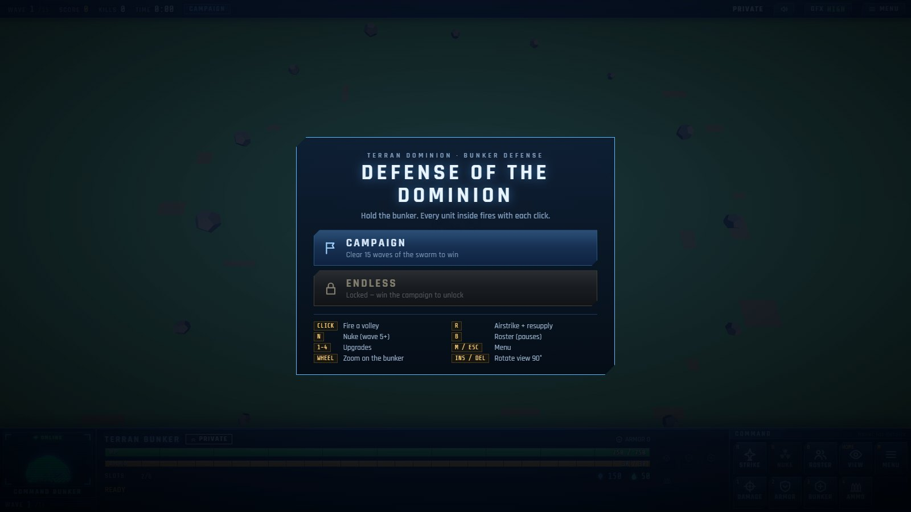
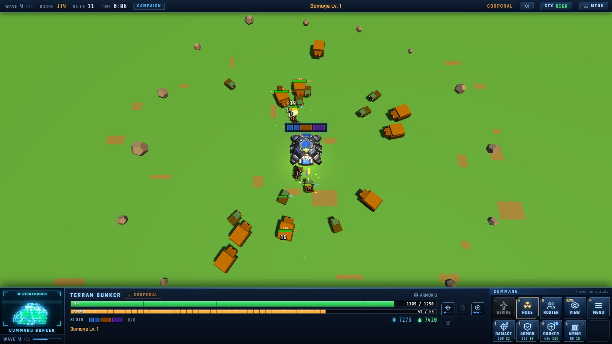
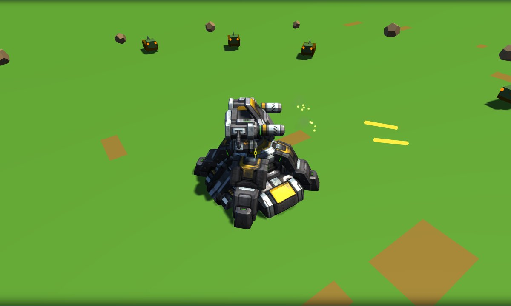
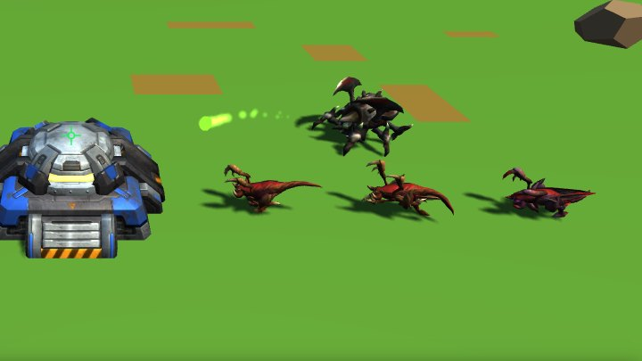
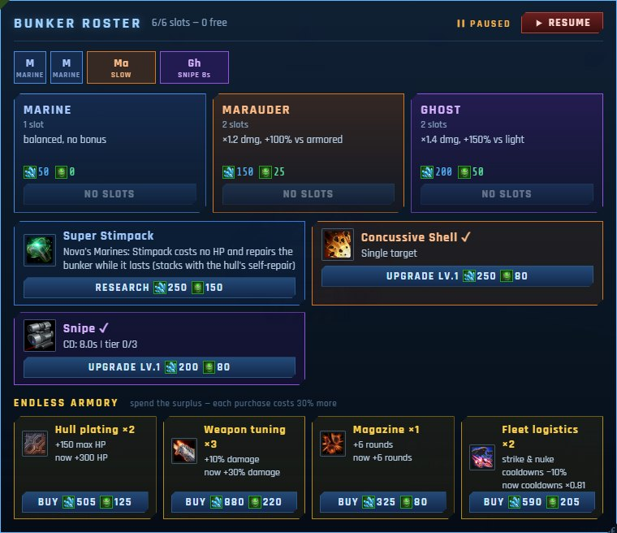
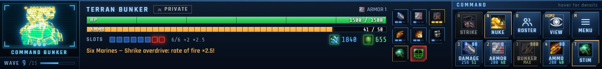

# Defense of the Dominion

A StarCraft II–style bunker defense game that runs in the browser — Three.js, no build step.

Hold a Terran bunker against waves of Zerg. Every unit inside the bunker fires with each click; spend the minerals and gas you earn on upgrades and new units, raise the bunker to the Shrike auto-turret, call in Viking airstrikes and nukes, and clear **15 waves** to win — which unlocks **Endless** mode.



| Battle (wave 9: winged Metabolic Boost Zerglings) | Shrike turret (Bunker Lv3) |
|---|---|
|  |  |
| **Zerglings: base, Metabolic Boost, webby skin — and a Roach spitting acid** | **Endless armory (roster panel)** |
|  |  |



## Running the game

**Play online:** <https://nam-usth.github.io/defense-of-the-dominion/> — published by GitHub Pages on every push to `main` (`.github/workflows/pages.yml`; only `index.html`, `css/`, `js/`, `assets/models/`, `assets/ui/` and `assets/audio/` go online). The repository settings must have **Pages → Source: GitHub Actions**.

On the web the StarCraft II assets (4.8 MiB gzipped) load in priority order — the bunker, then the Zerglings and the Marine, then the Roach, Viking and nuke, then the rest (`LOAD_STAGES` in `js/config.js`). The title screen shows the progress, and its start buttons wait for the first two stages (or *start now* skips the wait); everything else streams in while you play.

To run it locally you need a desktop browser with WebGL 2 (Chrome, Edge or Firefox) and, for the local server, Node.js 18 or newer.

```bash
npm start
```

Then open <http://localhost:8080>. To use another port: `node tools/serve.mjs 3000`.

Any static web server works (for example `python -m http.server 8080`). Opening `index.html` straight from disk is **not** enough: browsers block loading the 3D models over `file://`, and the game then falls back to simple procedural shapes.

An internet connection is needed for three.js (loaded from a CDN). The UI fonts also come from Google Fonts; without them the game uses system fonts.

## How to play

New players get a **tutorial**. The first game opens with a **HUD tour**: the HP and ammo bars, minerals and gas, then each command-card button in turn are spotlit (the rest of the screen dims) with what they do — BACK / NEXT, and **OK, LET'S ROLL** on the last page. After that, the first time something new happens (out of ammo, a cleared wave, an upgrade you can afford, room in the roster, the first Roach, the nuke, a damaged bunker, the Stimpack) the game pauses on a short hint that spotlights the control it is about. On a narrow screen the tour skips buttons that do not fit. Each shows once; **Menu → TUTORIAL** turns the hints off, starts them over or runs the tour again. **HOW TO PLAY** on the title screen has all the rules on one card, and its HUD TOUR button.

- **Campaign** — clear wave 15 (a bigger final assault) to win. Winning unlocks Endless for good (stored in the browser).
- **Endless** — no wave limit. Past wave 15 the swarm keeps growing, and so does the bunker: every wave adds **+5% damage, +60 max HP, +10% repair speed and +2 rounds** (the ∞ chip on the console shows the total; the damage, hull and ammo tooltips list it too). Your best wave and score are shown on the title screen.
- **Endless armory** — in Endless the roster panel (B) also sells repeatable upgrades for the minerals and gas that pile up once everything is researched: **Hull plating** +150 max HP, **Weapon tuning** +10% damage, **Magazine** +6 rounds, **Fleet logistics** airstrike and nuke cooldowns ×0.9 (down to 40%, i.e. an 8 s airstrike and a 6 s nuke). Each purchase costs 30% more than the last of its kind; the ROSTER button pulses between waves when you can afford one.
- **Shooting** — each click fires one volley: every unit in the bunker shoots once at the cursor (Marauders lock onto the nearest Roach while one is alive). One volley costs one round of ammo. **Hold** the button for full auto: after 0.25 s it fires a volley every 0.1 s wherever the cursor is, until you let go or the magazine is empty.
- **Ammo** — when the magazine is empty, press **R**: a Viking bombs every enemy cluster and drops an ammo crate, which one of your units (a Marine if one is free) runs out to fetch. Ammo is also restocked after every wave by a supply crate — **one crate per wave**: if the Viking's crate is still on its way when the wave ends (its bombs killed the last Zerg), the next wave waits for that crate instead of a second one, and if it already came in this wave, the magazine is refilled on the spot.
- **Resources** — kills and cleared waves pay minerals ◆ and vespene gas ▲.

### Units (bunker roster, 6 slots — press B)

| Unit | Slots | Cost | Strengths | Research |
|---|---|---|---|---|
| Marine | 1 | 50 ◆ | balanced | A full squad of six (6/6) unlocks **Stimpack** (T): 11 s of +50% fire rate for 10 HP per Marine, paid by the bunker. **Super Stimpack** (250 ◆ 150 ▲, Nova's Marines) makes it free and repairs the bunker 6 HP/s while it lasts — on top of the Lv3 hull's self-repair, so 31 HP/s with both (the HP bar shows the current rate). With the Shrike turret, six Marines also **overdrive** it: 2.5× rate of fire, red rounds |
| Marauder | 2 | 150 ◆ 25 ▲ | ×1.2 damage, +100% vs armored (Roach); fires punisher grenades and auto-aims at the nearest Roach | Concussive Shells — slows to 40% speed; tiers add an area slow (radius 1.5 / 2.2 / 3.0) |
| Ghost | 2 | 200 ◆ 50 ▲ | ×1.4 damage, +150% vs light (Zergling) | Snipe — auto-snipes the biggest threat; cooldown 8 → 6 → 4 → 2.5 s |

Dismissing a unit refunds 75%. Units fight from inside the bunker; you see them (StarCraft II models, walking) when one runs out to fetch a supply crate — a Marine if you have one. Only one unit leaves at a time, for one crate per wave. The bunker's HP is the squad's health: the Stimpack is paid from it, and only the Lv3 self-repair and Super Stimpack restore it.

### Enemies

- **Zergling** — light and fast, from wave 1; it bites the hull with its StarCraft II attack animation. From wave 8 it has **Metabolic Boost**: the winged model, 60% faster (SC2: 4.13 → 6.58); from wave 12 it wears the "webby" skin. Drawn at 0.8× its SC2 size so it reads smaller than the Roach.
- **Roach** — armored and tough, from wave 4. A ranged attacker, as in StarCraft II: it stops at range 4 from the hull and spits acid (damage lands when the glob hits). Its skin changes as the waves get harder: brown (wave 4), grey with green glow (wave 9), black with orange glow (wave 13).

### Upgrades (command card, keys 1–4)

| Key | Upgrade | Per level |
|---|---|---|
| 1 | Weapon damage | +60% damage |
| 2 | Bunker armor | damage taken (bites and acid) × 1/(1 + 0.35·level) |
| 3 | Bunker hull | +250 HP. **Lv2** adds the Neosteel frame; **Lv3** mounts the **Shrike turret** (auto-targets, twin barrels = 2 extra marines, no ammo; overdriven by a full Marine squad) and self-repair (25 HP/s; stacks with the Super Stimpack) |
| 4 | Ammo storage | +10 rounds |

The command card and the upgrade chips use StarCraft II button art that follows the level: Infantry Weapons Level 0 → 3 for damage; Magrail Munitions (Lv0–1), Magfield Accelerator (Lv2) and Enhanced Munitions (Lv3) for ammo; Fleet Calldown for the airstrike, the co-op nuke, the Detector eye for the view. Research has its own art (Super Stimpack — which also replaces the STIM icon once researched —, Explosive Shrapnel Shells for Concussive Shells, Laser Targeting System for Snipe), and the Shrike turret shows as a Hi-Sec Auto Tracking chip that pulses red in overdrive.

The **nuke** (N) unlocks at wave 5: a two-second warning while the warhead falls down the targeting laser, huge blast radius, 15 s cooldown. Below 50% HP the bunker starts to burn.

## Controls

| Input | Action |
|---|---|
| Left click | Fire a volley at the cursor |
| Hold left button | Full auto: a volley every 0.1 s (empties the magazine fast) |
| R | Airstrike + resupply (only when out of ammo) |
| N | Nuke (wave 5+) |
| T | Stimpack (six Marines in the bunker) |
| B | Bunker roster — hire units, research (pauses the game) |
| 1 · 2 · 3 · 4 | Upgrade damage · armor · bunker · ammo |
| Mouse wheel, + / − | Zoom in on the bunker / back out |
| Insert / Delete | Rotate the view 90° left / right (the view stays on the bunker) |
| Home | Reset the view |
| M or Esc | Menu (pauses), in tabs: GAME (save / load), SETTINGS (graphics, sound, day/night), CONTROLS, TUTORIAL, CHEATS — ↑ ↓ switch tabs |
| Q | Graphics quality HIGH / LOW |
| Y | Day/night cycle (experimental): a 3-minute cycle — day 78 s, dusk 24 s, night 54 s, dawn 24 s |
| K | Sound on / off |
| Enter, Space or Esc | Close a tutorial hint (a key the hint names, such as R or B, closes it and acts) |
| Enter / Space / →, ←, Esc | HUD tour: next page, previous page, end the tour |

Hover a command-card button for a tooltip with its cost, effect, and why it is disabled.

## Saving

- **Menu → SAVE / LOAD** — one manual save slot.
- **Autosave** after every cleared wave — **CONTINUE** on the title screen (also a checkpoint after the bunker falls).
- A save made during a wave restarts that wave; a save made between waves resumes at the next one.
- Everything is stored in the browser's `localStorage`: `dotd_save_v1`, `dotd_autosave_v1`, `dotd_endless_unlocked`, `dotd_endless_best`, `dotd_volume`, `dotd_muted`, `dotd_music`, `dotd_tutorial` (hints on / off and which ones were seen).

## Cheat codes

Type `dotd` during play to open the cheat console. `help` prints the full list to the browser console (F12).

| Code | Effect |
|---|---|
| `mng` | 7500 minerals + 7500 gas |
| `mineral` / `gas` | +500 minerals / +500 gas |
| `fu` | damage, armor and hull maxed (Shrike turret + self-repair) |
| `siege` · `bunker` | damage maxed · HP + armor maxed |
| `terran` | hire 2 Marines |
| `medic` · `immortal` | full repair · 99999 HP |
| `korhal` | reset airstrike and nuke cooldowns |
| `swarm` · `roachwave` | spawn 10 Zerglings · 5 Roaches |
| `wave` · `zergrush` | finish the current wave · jump ahead 5 waves (stops at the final wave in Campaign) |
| `airstrike` · `nuclear` · `kaboom` | 5 airstrikes · 3 nukes · a strike on every enemy |
| `general` | +280 kills (rank General) |
| `endv` · `endd` | win the campaign · lose the bunker |

## Project structure

```
index.html              page markup (top bar, console, menus) — loads the scripts below in order
css/hud.css             all styles
js/lib/obj-loader.js    minimal OBJ parser (THREE.OBJLoader) — for the bunker, Shrike and Viking
js/radial-fog.js        fog measured as distance from the bunker (the night vision circle)
js/config.js            game constants (CFG), model and texture paths (ASSETS), ranks
js/model-loader.js      loads GLB/OBJ models, DDS/JPG textures and baked walk/attack animations; SC2 team colour and normal maps
js/game.js              the game: scene, units, waves, combat, effects, HUD, menus, saving
assets/models/terran/   bunker, Shrike, Viking (OBJ) · Marine, Marauder, Ghost, nuke, grenade (GLB) — models and textures
assets/models/zerg/     Zergling (base, Metabolic Boost, webby skin) and Roach (three skins) — GLB models and textures
assets/ui/              HUD icons (PNG, converted from SC2 DDS)
assets/audio/           music: the StarCraft soundtrack, AAC
assets/source/m3/       the original .m3 files of the converted models (and unused effect models)
assets/source/terran/   extra model parts and a GLB that the game does not load
tools/serve.mjs         zero-dependency local web server (npm start)
.github/workflows/pages.yml   publishes the game to GitHub Pages
tools/import-sc2.mjs    converts/copies the imported SC2 models, textures and icons
tools/m3.mjs            .m3 reader (mesh, materials, skeleton, animation)
tools/m3-to-glb.mjs     .m3 → .glb, bind pose and baked animations in one file (what the game loads); --check validates a .glb
tools/m3-to-obj.mjs     .m3 → .obj, bind pose or a baked animation; lists a model; prints attachment points
tools/dds-to-png.mjs    .dds → .png (DXT1, DXT5, uncompressed)
tools/dds-resize.mjs    shrinks a .dds by dropping its largest mip levels (1024² → 512²)
tools/encode-music.mjs  any audio Chrome can play (FLAC, WAV, MP3…) → AAC .aac, with Chrome's own encoder
docs/screenshots/       images used in this README
```

The scripts are plain (non-module) scripts that share globals, so their order in `index.html` matters. When you change a CSS or JS file, bump its `?v=` number in `index.html` so browsers do not keep serving the cached copy.

## Using StarCraft II models

Every model in the game is a StarCraft II model with its own textures: the bunker (base textures, plus the upgrade texture on the Neosteel frame), the Shrike turret, the Marine, Marauder (Black Ops), Ghost (Black Ops body, Covert Ops texture), Roach (base, ex1a and ex3 skins), Zergling (`Zergling.m3`, and `ZerglingUpgrade.m3` for Metabolic Boost with its base and webby skins), the Viking and the falling nuke.

Known issue: the Marine texture on hand (`marine.dds`, `marine_normal.dds`) does not match the UV layout of `Marine.m3`, which asks for `marine_diffuse_blood.dds` and `Marine_Normal_Blood.dds` — the rifle shows the backpack panel. Extract those two and point the Marine's `TEXTURES` lines in `import-sc2.mjs` at them.

The `.m3` and `.dds` files come from the game's CASC archive (extract them with a CASC tool such as CascView). No Blender is needed: the tools in `tools/` read `.m3` directly. (The bunker, Shrike turret and Viking are older Blender conversions; their `.obj` files are kept as they are and the importer does not rebuild them.)

The SC2 models are stored as **GLB** (binary glTF): the bind pose and every baked animation frame in one file, with the frames sharing a single set of UVs and triangles. Positions and normals are packed with the standard `KHR_mesh_quantization` extension — positions as 16-bit integers inside the model's box (a step of about 2·10⁻⁵ model units), normals as 8-bit (under 0.3°) — and the game expands them to float32 when it loads them (`--float` on `m3-to-glb.mjs` writes plain float32 instead).

| The 8 SC2 models as | Files | Gzipped | Load + parse |
|---|---|---|---|
| OBJ text | 14.1 MiB, 17 files | 3.3 MiB | 528 ms |
| GLB, float32 | 3.9 MiB, 8 files | 2.2 MiB | 49 ms |
| GLB, quantized (used) | 2.1 MiB, 8 files | 1.1 MiB | about the same |

The frame rate does not depend on the format: once loaded, every version gives the same geometry on the GPU (checked vertex by vertex — the largest differences, 5·10⁻⁵ for OBJ text and 1.7·10⁻⁵ for the quantized GLB, are rounding). With the textures cut to 512² the whole site is 4.8 MiB gzipped (it was 11.2); on a connection throttled to 200 KB/s the bunker is ready after 14 s, the game can start after 25 s and everything has loaded after 61 s.

```bash
node tools/import-sc2.mjs D:/sc2-extract
```

`import-sc2.mjs` lists every file it imports. For each model it writes a `.glb` with the bind pose and, for units, the animations the game plays baked into frames (Walk; Roach and Zergling also Attack; 8 frames each, 32 for the Zergling's two-second walk of four gallops); it copies the textures under the names `ASSETS` expects (1024² maps cut to 512² by `dds-resize.mjs`: the units are a few dozen pixels tall and the bunker covers about 250 px even at full zoom, so nothing visible is lost while the site loads half as much), converts the HUD icons to PNG and keeps the `.m3` in `assets/source/m3`. To bring in a new model, add a line to its lists and an entry to `ASSETS` in `js/config.js`.

The individual tools:

```bash
node tools/m3-to-obj.mjs Roach.m3 --list                 # regions, textures, animations
node tools/m3-to-glb.mjs Roach.m3 roach.glb --anims Walk,Attack            # bind pose + 8 frames of each animation
node tools/m3-to-glb.mjs Zergling.m3 zergling.glb --anims Walk,Attack --frames Walk:32,Attack:8
node tools/m3-to-glb.mjs --check roach.glb               # validate a .glb
node tools/m3-to-obj.mjs Roach.m3 roach.obj              # the same as OBJ text (textured regions only; --regions 0,2 to pick)
node tools/m3-to-obj.mjs Roach.m3 roach_walk.obj --anim Walk --frames 8
node tools/m3-to-obj.mjs Roach.m3 --point "Ref_Head" --anim Attack --at 420   # where the acid leaves
node tools/dds-to-png.mjs icon-gas-terran.dds icon.png   # --size 32 to resize, --channel a to inspect a mask
```

`ASSETS` entries (see the comments in `js/config.js`):

- `glb` — the model file; several entries can share one (the Roach and Zergling skins), it is parsed once. `obj` (+ `walk` / `attack` frame files) still works for OBJ models, and is the fallback if a GLB fails to load.
- `tex: { diffuse, emissive, normal, normalY }` — DDS textures are flipped to match the model UVs automatically (GLB and OBJ store UVs the same way). `meshTex` overrides them for one mesh (the bunker's upgrade frame).
- `unitScale: SC2_SCALE` keeps SC2 models in their real proportions to the bunker; `scale` instead sets the size of the largest dimension.
- `teamColor` tints the team-colour mask SC2 stores in the diffuse alpha (Terran blue, Zerg red).
- `stride` — the distance one loop of the baked walk cycle covers (SC2 movement speed × loop length), so feet keep pace with the ground; `ANIM_SPEED` (1.25) then plays every walk and attack cycle a little faster, which looks livelier at the game's slower move speeds. The frames themselves are the GLB's `Walk_k` / `Attack_k` nodes (an OBJ model names separate `walk` / `attack` frame files instead). Attack timing lives in `ROACH_ACID` (spit, mouth position) and `ZERGLING_BITE`.
- `normalY: -1` (inside `tex` or a `meshTex` entry) — SC2 normal maps are DirectX-style (green points down), except some newer ones such as the Marauder Black Ops map, which are OpenGL-style.

Enemies are drawn as instances — one instance buffer per animation frame (walk and attack), frames nobody is on are skipped — so even 120 animated Roaches take only a few draw calls.

The Marauder's punisher grenade uses the mesh of `MarauderMissile.m3` (body and fireball); its texture (`Autoturret.dds`) has not been extracted, so it gets plain materials and a particle fire trail. The Roach acid (`RoachMissile.m3`, `RoachMissileImpact.m3`) is a pure particle system whose textures (`GooSplat_1.dds`, …) are missing too, so the glob and splash are drawn with the game's own particles. Not used yet, for want of their textures: the Marauder slow (`Lightning_DrkBlue.dds`), the nuke explosion (`firecloud2.dds`, `Fireball_10.dds`, `LargeSmoke2.dds`, …) and the falling nuke's smoke (`CloudSingleBlend.dds`, `Glow_Haze1.dds`). The grenade's own particle textures (`Fireball_10.dds`, `FireTail2.dds`, `ConcussiveSmoke1.dds`) are missing as well.

## Technical notes

- **Rendering** — three.js r128 from a CDN, no build tools. Enemies and bullets are `InstancedMesh`es and all particles live in two `THREE.Points` buffers, so a 140-enemy late-game fight takes about 20 draw calls.
- **Timing** — gameplay runs on a game clock with its own scheduler: pausing freezes everything, and restarting or loading drops pending events (wave countdowns, airstrikes, nukes).
- **Night** — the fog shader is patched to measure distance from the bunker, which gives the night mode its circle of vision. Dusk and dawn ease the night level in and out (smootherstep, no jump in the level or its rate); the fog radius shrinks by the same ratio every second (a geometric blend, 90 → 9 units) and the sun turns orange on the way, so the night closes in evenly instead of all at the end. Switching the cycle on or off blends over at most 2.5 s.
- **Sound** — the effects are synthesized with the Web Audio API (no audio files). The music is the StarCraft soundtrack by Glenn Stafford (`MUSIC` in `js/config.js`): *StarCraft Main Title* on the title screen, *Terran One*, *Two* and *Three* in turn during a game, *Terran Victory* / *Terran Defeat* on the results screen. The tracks are AAC 96 kbps (12 MiB in all), streamed by an `<audio>` element that only downloads the track it plays, through the same master volume and mute as the effects; the menu's MUSIC switch turns it off. Browsers allow sound only after the first click or key, so the title music starts then. To change a track: `node tools/encode-music.mjs "Terran One.flac" assets/audio/terran_one.aac` (or `ffmpeg -i in.flac -c:a aac -b:a 96k out.aac`).
- **Hologram** — the bunker portrait is a 2D-canvas projection of the model's edges and follows the bunker's upgrade stages.
- **SC2 materials** — one shader patch (`ModelLoader.teamColor`) handles the team-colour mask and rebuilds Z for SC2's two-channel (DXT5nm) normal maps.
- **Animation** — `tools/m3.mjs` decodes the skeleton and the bone tracks of an animation sequence; `m3-to-glb.mjs --anims` (or `m3-to-obj.mjs --anim`) skins the mesh offline into frames, so the game needs no skeletal animation at runtime: each frame is one more instance buffer.

## Credits

Non-commercial fan project — not affiliated with or endorsed by Blizzard Entertainment.

StarCraft® is a trademark or registered trademark of Blizzard Entertainment, Inc. The models, textures and icons in `assets/` (and the `.m3` sources in `assets/source/`) are © Blizzard Entertainment, Inc., all rights reserved, extracted from StarCraft II for this fan project. The music in `assets/audio/` is from the StarCraft soundtrack by Glenn Stafford, © Blizzard Entertainment, Inc. The game shows the same notice on its title screen. They will be taken down at Blizzard's request.

The code (`index.html`, `css/`, `js/`, `tools/`) was written for this project. three.js is © the three.js authors (MIT).
